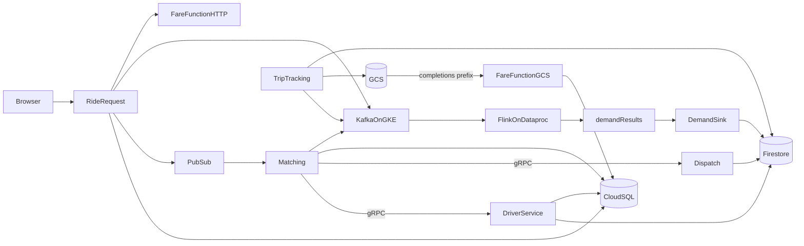

# Ride Sharing — group overview

This is the document the whole group reads before anyone writes code. It covers
ownership, the running system, the GCP resources, the live H3 zoning model, and
the evidence each person must be able to show.

Guides:

- [Person 1 — platform, Rider, Driver](01-person-1.md)
- [Person 2 — Ride Request, Matching, Dispatch, UI, observability](02-person-2.md)
- [Person 3 — Trip Tracking, Fare, Demand Analytics](03-person-3.md)
- [AWS to GCP migration](gcp-migration.md)
- [Platform runbook](platform-runbook.md)

Cloud is **Google Cloud Platform**, region `asia-south1`. The value nobody can
invent is the GCP project id. Everything else in the guides is fixed. The legacy
AWS baseline is kept for comparison and can be re-enabled with
`STORAGE_BACKEND=aws`; GCP is the default.

## 1. Division

Eight services and eight requirement letters cannot split into three equal
pairs. The professor's "2 services and 2 letters each" line assumes four people.
This split keeps every service and every letter owned by one person. Person 2
carries the extra service, the public UI, and the metrics stack. Person 3 keeps
the stream job.

| Person | Services they implement | Letters they defend in the viva | Extra |
|---|---|---|---|
| Person 1 | Rider Service, Driver Service | **a** Terraform, **d** GitOps, **g** GCS + Cloud SQL + Firestore | The cluster, network, IAM, Pub/Sub, Kafka, shared Python library |
| Person 2 | Ride Request Service, Matching Engine, Dispatch Service | **c** GKE, HPA, k6, **f** consistent hashing, **h** Prometheus, Grafana, Cloud Logging | The public web app and the professor checklist page |
| Person 3 | Trip Tracking Service, Fare Service, Demand Analytics Service | **b** Cloud Run functions plus REST, gRPC and Pub/Sub, **e** Flink on Dataproc | The stream job, the serverless function, the completion trigger, the demand page |

`task_division.txt` at the repo root must contain the real IDs and names before
submission.

## 2. How it works together

A rider and a driver never call GCP directly. They use one public URL, the Ride
Request service. That service is the only pod with an Ingress. Every other call
stays inside the VPC.



### One ride

1. The rider submits name and phone. Ride Request proxies to Rider Service,
   which inserts `riders` in Cloud SQL. Hop: REST, SQL.
2. The driver submits name and phone, then goes online with a **live browser
   location**. Driver Service stores the profile in Cloud SQL. It converts the
   latitude/longitude into an **H3 cell**, hashes that cell onto the ring, and
   writes the live item to Firestore under that `partition_id` with status
   `AVAILABLE`. It publishes `DRIVER_STATUS` to Kafka `ride-events`. Hop: REST,
   NoSQL.
3. The rider uses browser geolocation for pickup and an OpenStreetMap/Leaflet
   map for the destination. Ride Request inserts `ride_requests` with status
   `REQUESTED`, calls the Fare function over HTTP, publishes the match command
   to Pub/Sub, and publishes `RIDE_REQUESTED` to Kafka.
4. Matching pulls Pub/Sub. It hashes the pickup H3 cell with the same ring,
   groups the H3 neighbours by partition owner, calls Driver gRPC
   `GetCandidates` once per partition, then calls Dispatch gRPC `Assign` for
   each candidate until one succeeds.
5. Dispatch updates the Firestore item only when `status = AVAILABLE`, or when
   the same `ride_id` already holds it. A second ride cannot take that driver.
   Matching writes `ASSIGNED` and publishes `RIDE_ASSIGNED`. If every candidate
   fails, the ride becomes `NO_DRIVER`.
6. The driver moves the trip through `ARRIVING`, `IN_PROGRESS`, and `COMPLETED`
   on Trip Tracking. Progress is stored in Cloud SQL, GPS samples go to GCS
   under `gps/{ride_id}/`, and each change is a `TRIP_UPDATED` event on Kafka.
   On `COMPLETED`, Trip Tracking writes `completions/{ride_id}.json` and sets
   the driver back to `AVAILABLE`.
7. The GCS object under `completions/` triggers the Fare Cloud Run function.
   The function computes the final fare from the actual pickup/drop
   coordinates, including surge, and writes `fare_quotes` plus
   `ride_requests.final_fare_cents`.
8. Flink on Dataproc reads `ride-events`, keys by H3 cell, and aggregates a
   1-minute event-time window: unique riders, request count, assigned count,
   drivers whose last status in the window is `ONLINE`. Queue length is
   `max(0, requests - assigned)`. Imbalance is
   `requests / max(online_drivers, 1)`. Flink writes one JSON object per cell per
   window to `demand-results`. The demand sink copies that topic into Firestore
   collection `rideshare_demand_windows`. The demand page reads it.

The trace page is this list for one ride id. Every service inserts a row into
`ride_hops`. That table proves letter **b** and letter **g** without opening
five consoles.

### Live H3 zoning and consistent hashing

There is no fixed city box. A zone is an **H3 cell** computed from the live
latitude/longitude of the rider or driver.

- Default resolution: `H3_RESOLUTION=8` (about 0.7 km² per cell).
- Driver presence: `zone_for(lat, lng)` returns the H3 cell.
- Neighbours: `grid_disk(cell, H3_NEIGHBOR_K)`, default `k=1`, which includes
  the cell itself and its six neighbours.
- Fare: uses the actual pickup and drop coordinates, not cell centres.
- Ring: partitions `p0,p1,p2,p3`; `MD5(cell_id)` picks the first ring point
  clockwise. Adding `p4` moves only the cells whose owner changes.
- Ring demo: the page samples H3 cells around the browser's live location
  (`k=3`) and previews the before/after ownership. It never changes the live
  `HASH_NODES`.
- Matching must query every partition that owns a neighbour cell, because H3
  neighbours can be owned by different partitions.

Hashing the cell keeps a neighbourhood mostly in one partition. Hashing driver
ids would scatter one neighbourhood across every partition.

### Why these GCP products

- **GKE Standard** hosts the Kubernetes services. Ride state is in Cloud SQL
  and Firestore, so a pod can die without losing a ride. Letter **c**.
- **Argo CD** is the only way those Deployments change. Terraform installs Argo
  CD itself. After that, a service change is a git commit. Letter **d**.
- **Cloud SQL PostgreSQL 16** holds riders, driver profiles, rides, trips,
  fares, and hops. Those are relational and are updated together.
- **Firestore Native** holds live driver availability and demand windows. The
  assign path is a Firestore transaction. Two matchers cannot both win.
- **Cloud Storage** holds raw GPS samples and the completion file. The
  completion file triggers Fare. This is the object store in letter **g**, and
  the trigger in letter **b**.
- **Pub/Sub** is the work queue for "match this ride". It has a dead-letter
  topic after 5 delivery attempts. Kafka is not used as the work queue, because
  a match is a command that must be acknowledged, not a replayable event.
- **Strimzi Kafka on GKE** is the event log. Flink is required to consume
  Kafka. Brokers have no public endpoint; GKE clients use the internal listener
  on `9094` and Dataproc uses an internal load-balancer listener on `9095`.
- **Cloud Run functions (2nd gen)** is Fare, and only Fare. Estimate is HTTP.
  Final fare is the GCS Eventarc event. One service, two entry points.
- **Dataproc with Flink** runs the stream job. The cluster is off until the
  stream demo. Checkpoints go to GCS. The state backend is RocksDB.
- **Prometheus and Grafana** run on the cluster. Pod stdout, GKE, Dataproc and
  Cloud Run logs go to **Cloud Logging**. Letter **h**.
- **Artifact Registry** stores images. **Secret Manager** stores the database
  URL and demo token. **Workload Identity** gives each Kubernetes service
  account its own Google service account.

### Cloud mapping from the legacy AWS baseline

| AWS | GCP |
|---|---|
| EKS | GKE Standard |
| RDS PostgreSQL | Cloud SQL PostgreSQL 16 |
| DynamoDB | Firestore Native |
| S3 | Cloud Storage |
| SQS + DLQ | Pub/Sub topic + subscription + DLQ |
| MSK | Strimzi Kafka on GKE |
| ECR | Artifact Registry |
| Lambda + API Gateway + S3 notification | Cloud Run functions 2nd gen + Eventarc |
| EMR Flink | Dataproc with Flink |
| CloudWatch Logs | Cloud Logging |
| IRSA | Workload Identity |
| AWS Load Balancer Controller / ALB | GKE Ingress / Google Cloud Load Balancing |
| Fluent Bit | GKE Cloud Logging integration |

## 3. Checklist, and where it is proved

| Id | Requirement | Proved by |
|---|---|---|
| Group | At most 4 people, one submission, each person can demo their own part | `task_division.txt` and the three viva scripts |
| App | Eight services, one public URL | The pages on the Ride Request Ingress |
| S1 | Rider profiles | Rider page, `riders` table |
| S2 | Driver status and availability | Driver page, `rideshare_driver_live` |
| S3 | Request id | `ride_requests.id` on the trace |
| S4 | Candidate drivers | gRPC hop `GetCandidates` on the trace |
| S5 | One assignment, no double book | gRPC hop `Assign`, then the conflict button |
| S6 | Trip progress | Trip buttons and `TRIP_UPDATED` hops |
| S7 | Estimate and final fare | Both amounts on the ride |
| S8 | Demand, queue length, imbalance | Demand page, 1-minute window bounds |
| a | All infrastructure is Terraform | `terraform state list` |
| b | One serverless event function; REST, gRPC and a queue all used | Cloud Run function log plus one trace |
| c | Managed Kubernetes, two HPAs, sustained load, replicas increase | k6 plus the checklist replica row |
| d | GitOps from git, no `kubectl apply` for services | Argo CD revision equals git |
| e | Flink, Kafka in, stateful 1-minute window, separate results topic | Demand page and `demand-results` |
| f | Consistent hashing, shown live | Ring page |
| g | Object store, SQL, NoSQL, and the file triggers the function | Trace labels plus the function log |
| h | Prometheus, Grafana, RPS, errors, latency, cluster health, centralized logs | Grafana and Cloud Logging |
| Doc | Design document with the six required parts | `docs/design.md` |
| Repo | Code, Terraform, manifests, GitOps | GitHub `main` |
| File | `task_division.txt` | Repo root |

The checklist page starts every row as "Show this screen" or "Not built yet."
It marks a row Proven only when it can see the evidence: all health checks green,
a finished ride that contains every hop, a ring preview where at least one cell
stayed, and replica counts above the minimum while k6 is running. Terraform,
Argo CD, Grafana and Cloud Logging stay "Show this screen" with the exact
command or URL. Person 3 proves the demand window on the Trip Tracking demand
page, not on this checklist.

## 4. Frozen names

| Thing | Value |
|---|---|
| Project | `<gcp-project-id>` |
| Region | `asia-south1` |
| Zone | `asia-south1-a` |
| VPC | `rideshare-vpc`, `10.20.0.0/16` |
| Subnet | `rideshare-subnet`, `10.20.0.0/20` |
| Pods range | `rideshare-pods`, `10.24.0.0/14` |
| Services range | `rideshare-services`, `10.28.0.0/20` |
| GKE | `rideshare`, zonal, nodes `e2-standard-2`, min 2, max 4 |
| Namespace | `rideshare` |
| Cloud SQL | `rideshare-pg`, PostgreSQL 16, database `rideshare`, user `rideshare` |
| Firestore | Native mode `(default)` |
| Driver collection | `rideshare_driver_live` |
| Demand collection | `rideshare_demand_windows` |
| Trip bucket | `rideshare-trip-files-<project-id>` |
| Function source bucket | `rideshare-function-source-<project-id>` |
| Dataproc staging bucket | `rideshare-dataproc-<project-id>` |
| Pub/Sub topic | `rideshare-match-jobs` |
| Pub/Sub subscription | `rideshare-match-jobs-sub` |
| Pub/Sub DLQ | `rideshare-match-jobs-dlq` |
| Kafka cluster | `rideshare-kafka`, Strimzi, 3 brokers |
| Topics | `ride-events`, `demand-results` |
| Cloud Run functions | `rideshare-fare-estimate`, `rideshare-fare-final` |
| Dataproc | `rideshare-flink`, optional component `FLINK` |
| Artifact Registry | `asia-south1-docker.pkg.dev/<project>/rideshare` |
| Secret Manager | `rideshare-database`, `rideshare-demo-token` |
| Hash nodes | `p0,p1,p2,p3` |
| H3 | resolution 8, neighbour k 1, ring sample k 3 |
| Ports | rider 8001, driver 8002 and gRPC 9002, ride-request 8003, matching 8004, dispatch 8005 and gRPC 9005, trip 8006, sink 8010 |
| Argo CD Helm | chart `argo-cd` version `10.11.6` |

Environment variables, same on every pod that needs them:

```text
STORAGE_BACKEND=gcp
GCP_PROJECT
FIRESTORE_DATABASE
DRIVER_COLLECTION
DEMAND_COLLECTION
DATABASE_URL
TRIP_BUCKET
MATCH_TOPIC
MATCH_SUBSCRIPTION
KAFKA_BOOTSTRAP
KAFKA_TOPIC_EVENTS
KAFKA_TOPIC_RESULTS
KAFKA_SECURITY_PROTOCOL
KAFKA_SSL_CA_FILE
KAFKA_SSL_CHECK_HOSTNAME
HASH_NODES
H3_RESOLUTION
H3_NEIGHBOR_K
FARE_ESTIMATE_URL
DEMO_TOKEN
SERVICE_NAME
```

Legacy AWS variables are kept in `services/common/rideshare/aws.py` and can be
used with `STORAGE_BACKEND=aws`: `AWS_REGION`, `AWS_ENDPOINT_URL`,
`DRIVER_TABLE`, `DEMAND_TABLE`, `MATCH_QUEUE_URL`.

`DEMO_TOKEN` protects the conflict button. The ring preview's "add node" maths
is public and read-only.

Kafka event envelope. Producers must send this shape. Flink ignores anything
else.

```json
{
  "event_id": "uuid",
  "event_type": "RIDE_REQUESTED",
  "event_time": "2026-10-28T12:00:00Z",
  "zone": "8928308280fffff",
  "ride_id": "uuid",
  "rider_id": "uuid",
  "driver_id": "",
  "payload": {}
}
```

`event_type` is one of `RIDE_REQUESTED`, `RIDE_ASSIGNED`, `DRIVER_STATUS`,
`TRIP_UPDATED`. `DRIVER_STATUS` puts `{"status":"ONLINE"}` or `OFFLINE` in
`payload`. `TRIP_UPDATED` puts `{"status":"ARRIVING"}` and later states in
`payload`. `event_time` is the timestamp Flink uses. It is UTC with a `Z`.

Fare formula, used by both function handlers:

```text
base = 4000 paise
per_km = 1200 paise
per_min = 200 paise
speed = 25 km/h
duration_min = distance_km / speed * 60
surge = 2.0 if imbalance >= 3 else 1.5 if imbalance >= 1.5 else 1.0
amount = round((base + distance_km * per_km + duration_min * per_min) * surge)
```

Distance is the haversine distance between the actual pickup and drop
coordinates. The H3 cells are used for routing, partitioning and demand
aggregation, never for the fare distance.

## 5. Build order

1. Person 1 creates the GCP project, enables billing, applies `infra/bootstrap`,
   then `infra/platform`, then `infra/k8s`. Send the outputs to the group.
2. Person 2 commits `services/common/rideshare/hashring.py`, the protobuf files
   and the ring test.
3. Person 1 commits the shared library, Rider, Driver, the migrate job and the
   Argo CD applications. Build and push those images. Argo CD syncs them.
4. Person 2 commits Ride Request, Matching, Dispatch, the UI and the HPAs. Push
   images. Write the tags with `scripts/configure.py`.
5. Person 2 commits Grafana and the dashboard. Person 3 commits Trip Tracking,
   the Fare zip, the demand sink and the Flink jar. Person 1 applies
   `infra/functions`. Push the trip and sink images.
6. On the stream demo day, Person 3 uploads the jar, Person 1 applies
   `infra/dataproc`, and the job is submitted. Destroy that stack the same day.
7. Person 2 runs k6 against the public URL and opens Grafana. The group walks
   the demo script.

Local checks that do not need GCP:

- `.venv/bin/python -m pytest -q tests/platform`
- `scripts/check-platform.sh`
- `docker compose up` starts Postgres, Firestore emulator, Pub/Sub emulator,
  fake GCS, Kafka, Rider and Driver. The legacy LocalStack service is retained
  but unused.

## 6. Demo the group walks, in this order

1. Open `/checklist`. Show which rows are already Proven.
2. Create a rider. Create two drivers. Use the browser location button and go
   online. The driver page shows the H3 cell and partition.
3. Use the map to pick a destination near the driver. Show the estimate, the
   request id and the trace: REST, Pub/Sub, gRPC candidates, gRPC assign, SQL,
   NoSQL.
4. Request a second ride from the same cell. Show that driver A was not
   assigned twice. The second ride gets driver B, or the conflict button shows
   `assigned: false`.
5. Open `/ring`. Show the live cells around the browser location. Add `p4`.
   Read the moved-cell count and the stayed-cell count.
6. Complete the trip. Show the GCS completion object, the Cloud Run log line
   with the ride id, and the final fare appearing on the page.
7. Person 3 opens the Trip Tracking demand page after the minute rolls. Show
   unique riders, queue length, imbalance, window start, window end and
   `demand-results`.
8. Run k6 for four minutes. Show Ride Request and Matching replicas go from 2 to
   more than 2. Open Grafana and show the same traffic on the RPS panel.
9. Open Argo CD and show the git SHA. Open `terraform state list` and show the
   network, cluster, databases, bucket, Pub/Sub, Kafka and IAM.

## 7. Cost and teardown

GKE control plane, Cloud NAT, Cloud SQL, the load balancers and the Strimzi
brokers are the standing cost. Dataproc is the spike. Do not leave Dataproc up
overnight. Person 1 runs this when the group is finished for the day:

```bash
gcloud dataproc clusters delete rideshare-flink --region=asia-south1 --quiet
terraform -chdir=infra/dataproc destroy -auto-approve -var="project_id=PROJECT_ID"
terraform -chdir=infra/functions destroy -auto-approve -var="project_id=PROJECT_ID"
terraform -chdir=infra/k8s destroy -auto-approve -var="github_repo=REPO_URL"
terraform -chdir=infra/platform destroy -auto-approve -var="project_id=PROJECT_ID"
```

Skip a directory that was never applied. Cloud SQL is created with
`deletion_protection = false` for the course project. A system that had to keep
data would set deletion protection and take a final backup.

## 8. Production rules

- Encryption at rest on Cloud SQL, Firestore, GCS, Kafka broker disks and
  Secret Manager. TLS from clients to Kafka. Brokers have no public endpoint.
  Kafka uses ephemeral disks in this demo; a persistent deployment would switch
  the Strimzi storage type to `persistent-claim`.
- Database password is a random 24-character string with no symbols, stored in
  Secret Manager and injected as a Kubernetes Secret. It is not in git.
- One Google service account per Kubernetes service account (Workload
  Identity). The driver can write only the driver collection. Dispatch can
  update only that collection. Trip Tracking can write only the trip bucket and
  update driver status. The sink can write only the demand collection.
- Pub/Sub dead-letter topic after 5 delivery attempts. Assign is transactional
  and idempotent for the same ride id.
- Ride create takes `idempotency_key`. A retry returns the original ride.
- Pods run as UID 65532, with a readiness probe, CPU request 100m and CPU limit
  500m. The two HPAs target 60 percent of the request.
- JSON logs on stdout include `service`, `ride_id` and `event`. GKE sends them
  to Cloud Logging.
- Every service exposes Prometheus counters and a latency histogram.
- Database schema is applied by an Argo CD sync hook, not by hand.
- Images are pinned to a git SHA. `:latest` is not used.
