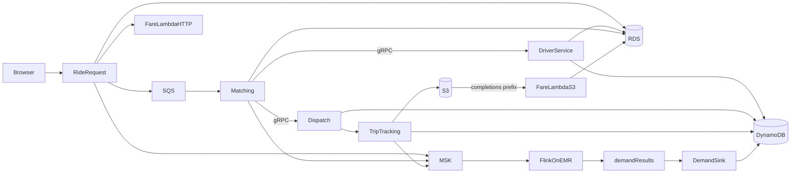
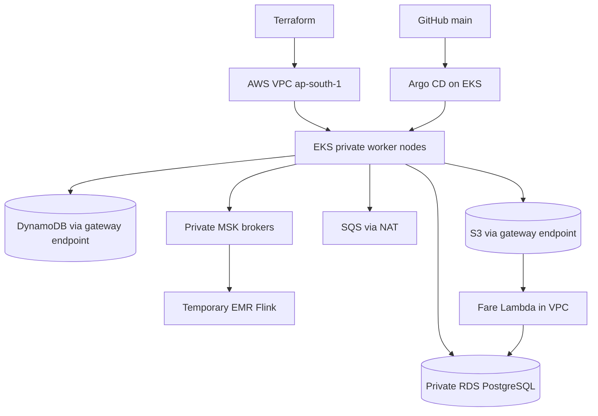
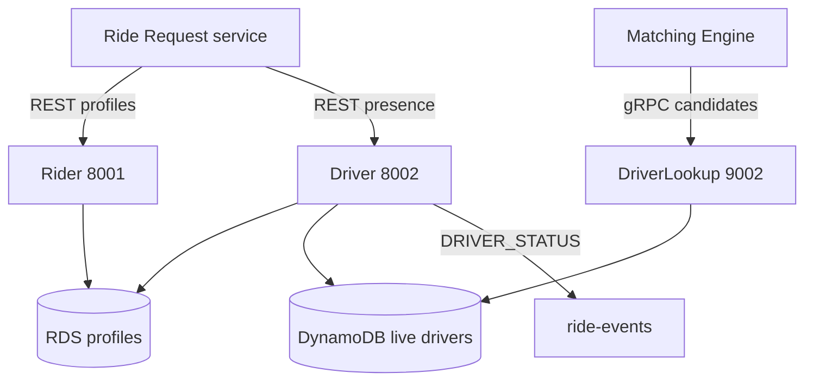

# Ride Sharing — design document

Team: fill names and IDs in `task_division.txt` before submission.

Implementation status: this contribution implements the platform infrastructure and Rider/Driver services. The following
system design describes the target integration for all eight services. Person 2
and Person 3 must review their sections and attach their deployment evidence.

## 2. How it works together

A rider and a driver never call AWS. They use one public URL, the Ride Request service. That service is the only pod with a load balancer. Every other call stays inside the VPC.

### One ride

1. The rider submits name and phone. Ride Request proxies to Rider Service, which inserts `riders` in RDS. Hop recorded: REST, SQL.
2. The driver submits name and phone, then goes online with a latitude and longitude. Driver Service stores the profile in RDS. It turns the coordinates into one of 16 zones (`z00` through `z33`), hashes that zone onto the ring, and writes the live item to DynamoDB under that `partition_id` with status `AVAILABLE`. It also publishes `DRIVER_STATUS` to Kafka topic `ride-events`. Hop: REST, NoSQL.
3. The rider requests a pickup and a drop. Ride Request inserts `ride_requests` with a UUID, status `REQUESTED`, and calls the Fare Lambda over HTTP for an estimate. The estimate is `₹40 + ₹12/km + ₹2/min`, times a surge read from the latest demand window (1.0 if no window exists yet). Ride Request sends the job to SQS queue `rideshare-match-jobs` and publishes `RIDE_REQUESTED` to `ride-events`.
4. Matching Engine polls SQS. It hashes the pickup zone with the same ring, calls Driver Service over gRPC `GetCandidates` for that partition and the neighboring zones, then calls Dispatch over gRPC `Assign` for each candidate until one succeeds.
5. Dispatch updates the DynamoDB item only when `status = AVAILABLE`, or when this same `ride_id` already holds it. The second case makes an SQS retry safe. A second ride cannot take that driver. Matching writes `ASSIGNED` on the ride row and publishes `RIDE_ASSIGNED`. If every candidate fails, the ride becomes `NO_DRIVER`.
6. The driver moves the trip through `ARRIVING`, `IN_PROGRESS`, and `COMPLETED` on Trip Tracking. Progress is stored in RDS, location samples go to S3 under `gps/{ride_id}/`, and each change is a `TRIP_UPDATED` event on `ride-events`. On `COMPLETED`, Trip Tracking also writes `completions/{ride_id}.json` and sets the driver back to `AVAILABLE`.
7. The S3 object under `completions/` invokes the Fare Lambda. The function computes the final fare, including surge, and writes `fare_quotes` plus `ride_requests.final_fare_cents`. The browser is polling the ride and shows the final amount when that column fills in.
8. Flink on EMR reads `ride-events`, keys by zone, and aggregates a 1-minute event-time window: unique riders, request count, assigned count, drivers whose last status in the window is `ONLINE`. Queue length is `max(0, requests - assigned)`. Imbalance is `requests / max(online_drivers, 1)`. Flink writes one JSON object per zone per window to `demand-results`. The demand sink (a pod that belongs to Demand Analytics, not a ninth service) copies that topic into DynamoDB table `rideshare_demand_windows`. The demand page reads it.

The trace page is this list for one ride id. Every service inserts a row into `ride_hops`. That table is how the group proves letter **b** and letter **g** without opening five consoles.

### Consistent hashing

There are 16 zones on a 4 by 4 grid over a fixed map box (a demo city in the Hyderabad area). The ring has virtual nodes for partitions `p0`, `p1`, `p2`, `p3`. The partition for a zone is the first ring point clockwise from `MD5(zone)`. Adding `p4` moves about `1/5` of the zones. Zones that do not move keep their DynamoDB partition key, so those drivers are not rewritten. The ring page shows the before and after. It does not change the live ring. The live ring is the environment variable `HASH_NODES`.

Driver id is not the hash key. Hashing driver ids would scatter one neighborhood across every partition, and matching would have to read all of them. Hashing the zone keeps a neighborhood in one partition. Matching still reads the partitions that own the adjacent zones, because a rider can stand on a border.

### Why these AWS products

- **EKS** hosts the six stateless services. Ride state is in RDS and DynamoDB, so a pod can die without losing a ride. This is letter **c**.
- **Argo CD** is the only way those Deployments change. Terraform installs Argo CD itself. After that, a service change is a git commit. This is letter **d**. `kubectl apply` is not part of the deploy path.
- **RDS PostgreSQL** holds riders, driver profiles, rides, trips, fares, and hops. Those are relational and are updated together.
- **DynamoDB** holds live driver availability and the latest demand windows. The assign path is a conditional `UpdateItem`. Two matchers cannot both win.
- **S3** holds raw GPS samples and the completion file. The completion file is the event that runs Fare. This is the object store in letter **g**, and the trigger in letter **b**.
- **SQS** is the work queue for “match this ride.” It has a dead-letter queue after 5 receives. Kafka is not used as the work queue, because a match is a command that must be acknowledged, not a replayable event.
- **MSK** is the event log. Flink is required to consume Kafka. Brokers have no public endpoint. The only ingress is the VPC itself, so EKS and EMR can reach them and the internet cannot.
- **Lambda** is Fare, and only Fare. Estimate is an HTTP call. Final fare is the S3 event. One service, two entry points.
- **EMR 7.14.0** runs Flink 1.20. The cluster is off until the stream demo. Checkpoints go to S3. The state backend is RocksDB.
- **Prometheus and Grafana** run on the cluster. Logs from the pods, MSK, EMR, and Lambda go to CloudWatch Logs. Letter **h** asks for Prometheus and Grafana by name, and accepts Cloud Logging. CloudWatch is that store on AWS.

### Checklist, and where it is proved

| Id | Requirement | Proved by |
|---|---|---|
| Group | At most 4 people, one submission, each person can demo their own part | `task_division.txt` and the three viva scripts |
| App | Eight services, one public URL | The six pages on the Ride Request load balancer |
| S1 | Rider profiles | Rider page, `riders` table |
| S2 | Driver status and availability | Driver page, `rideshare_driver_live` |
| S3 | Request id | `ride_requests.id` shown on the trace |
| S4 | Candidate drivers | gRPC hop `GetCandidates` on the trace |
| S5 | One assignment, no double book | gRPC hop `Assign`, then the conflict button |
| S6 | Trip progress | Trip buttons and `TRIP_UPDATED` hops |
| S7 | Estimate and final fare | Both amounts on the ride |
| S8 | Demand, queue length, imbalance | Demand page, 1-minute window bounds |
| a | All infrastructure is Terraform | `terraform state list` |
| b | One serverless event function; REST, gRPC, and a queue all used | Lambda log plus one trace |
| c | Managed Kubernetes, two HPAs, sustained load, replicas increase | k6 plus the checklist replica row |
| d | GitOps from git, no `kubectl apply` for services | Argo CD revision equals git |
| e | Flink, Kafka in, stateful 1-minute window, separate results topic | Demand page and `demand-results` |
| f | Consistent hashing, shown live | Ring page |
| g | Object store, SQL, NoSQL, and the file triggers the function | Trace labels plus the Lambda log |
| h | Prometheus, Grafana, RPS, errors, latency, cluster health, centralized logs including Flink | Grafana and CloudWatch |
| Doc | Design document with the six required parts | `docs/design.md` |
| Repo | Code, Terraform, manifests, GitOps | GitHub `main` |
| File | `task_division.txt` | Repo root |

The checklist page starts every row as “Show this screen” or “Not built yet.” It marks a row Proven only when it can see the evidence: all health checks green, a finished ride that contains every hop, a ring preview where at least one zone stayed, a demand window newer than 15 minutes, and replica counts above the minimum while k6 is running. Terraform, Argo CD, Grafana, and CloudWatch stay “Show this screen,” with the exact command or URL. The app does not get AWS admin rights just to paint a green tick.

## Platform and profile services implementation

Rider uses REST and PostgreSQL for profiles. Unique phone constraints prevent duplicate
registrations; concurrent duplicate requests return HTTP 409. Driver profiles are also
relational. Driver presence is a DynamoDB item keyed by the consistent-hash owner of
its geographic zone and driver ID. DriverLookup exposes gRPC on 9002 to Matching.
The profile row lock serializes presence updates; a conditional DynamoDB transaction
moves a live item between partitions without resetting an assigned driver. Assignment
uses a conditional update: a second ride fails, and retries by the same ride succeed.
The fixed HASH_NODES configuration must be identical across services; changing the live
ring requires a migration, while Person 2's ring preview is read-only.

Terraform is separated into bootstrap, platform, Kubernetes, Lambda and EMR states.
Argo CD is installed by Terraform; a small local Helm chart installs the Application
objects after its CRDs. Git changes own application Deployments thereafter. Initial
GitOps sync includes only migrate, rider and driver until the other owners finish.

The shared library provides database pooling and migration, zone geometry, consistent
hashing, fare math, S3/SQS/DynamoDB/Kafka adapters, metrics and structured logs. The local
Compose stack runs PostgreSQL, LocalStack, Kafka, migration, Rider and Driver. It does
not implement the remaining teammates' services.

## Deployment architecture

## Rider and Driver responsibilities

## Validation and limitations

See `docs/platform-runbook.md`. Unit/API checks use mocked SQL and Moto AWS emulation;
gRPC uses a real loopback server. Live PostgreSQL, Docker images, Terraform providers,
AWS deployment and Argo CD synchronization still require the deployment runbook.
Kafka publication reports failure via `kafka: false`; this demo has no transactional
SQL/event outbox. Presence migration supports the configured partitions only; do not
remove live HASH_NODES entries without migrating old records. Team integration should
also make Trip Tracking completion/release idempotent before claiming end-to-end
retry guarantees. EMR logs use S3; Person 2/3 must add and verify CloudWatch collection
for Flink to complete the centralized logging requirement.
