# Metered — Design Document

**Product:** Metered (cloud-native ride matching)  
**Cloud:** Google Cloud Platform · **Region:** `asia-south1` · **Project:** `metered-513804`  
**Repo:** https://github.com/pratham-commits/metered  
**Team:** Ved Pahune (`2026H1030056P`) · Pratham Shah (`2026H1030063P`) · Vidhu Kant Sharma (`2026H1030053P`)  
**Ownership file:** [`task_division.txt`](../task_division.txt)

This document is the submission design write-up. It is organized as the **six required parts**, then appendices (data model, reliability, security, observability, operations). Diagram sources also live under [`docs/diagrams/`](diagrams/) and in [`Metered-Cloud-Architecture.pptx`](Metered-Cloud-Architecture.pptx).

---

# Part 1 — System overview

## 1.1 Problem and product

Metered is a **cloud-native ride-matching system**. A rider requests a ride from a browser. The platform:

1. Records rider and driver identity.
2. Publishes the driver’s live location into a geospatial partition.
3. Matches a nearby available driver asynchronously.
4. Assigns that driver **exactly once**.
5. Tracks trip progress and GPS samples.
6. Computes an estimate and a **final fare**.
7. Computes **zone demand** from a live event stream.

The browser never talks to Google APIs or private services directly. It talks to **one public Backend-for-Frontend (BFF)**: Ride Request.

## 1.2 Design principles

| Principle | How Metered applies it |
|---|---|
| Single public surface | Only Ride Request has Ingress / public HTTP |
| Separation of sync vs async | Create/accept are request/response; matching is Pub/Sub |
| Events vs commands | Kafka carries domain events; Pub/Sub carries match *jobs* |
| Three storage products | Cloud SQL (relational), Firestore (live NoSQL), GCS (objects) |
| Git as deploy source of truth | Images tagged by git SHA; Argo CD syncs manifests |
| Demoable letters | Every assignment letter maps to a live screen or command |

## 1.3 The eight services

| # | Service | Role in one sentence |
|---|---|---|
| 1 | **Rider** | Create/store rider profiles in Cloud SQL |
| 2 | **Driver** | Profiles in SQL + live presence in Firestore (H3 cell + partition) |
| 3 | **Ride Request** | Public BFF + UI: rides, proxies, checklist, trace, ring |
| 4 | **Matching** | Consume match jobs; find candidates by hashed H3 neighbourhood |
| 5 | **Dispatch** | Atomic assign of a driver to a ride (gRPC + Firestore txn) |
| 6 | **Trip Tracking** | Trip states, GPS objects, completion JSON, demand page API |
| 7 | **Fare** | Serverless estimate (HTTP) + finalize (Eventarc on GCS) |
| 8 | **Demand Analytics** | Flink on Dataproc + demand-sink pod writing Firestore windows |

Demand Analytics counts as **one** service: the Flink job plus the small Kafka→Firestore sink that materializes results for the UI.

## 1.4 Logical view (who talks to whom)

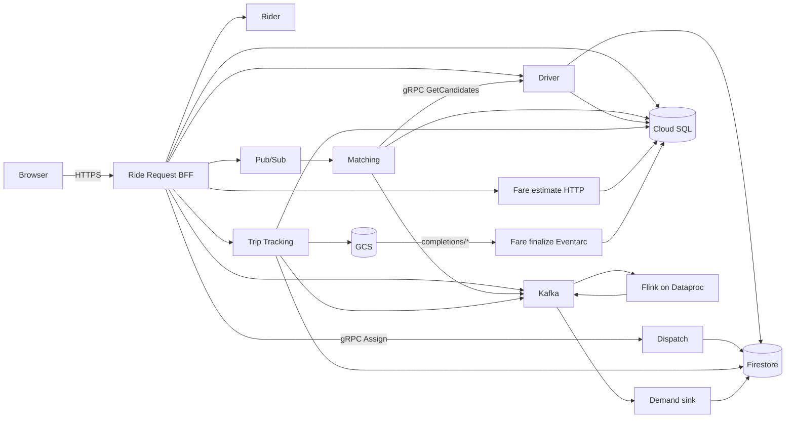

**Invariant:** Matching may *propose* candidates; only Dispatch **writes** the live assignment lock.

## 1.5 One complete ride (narrative)

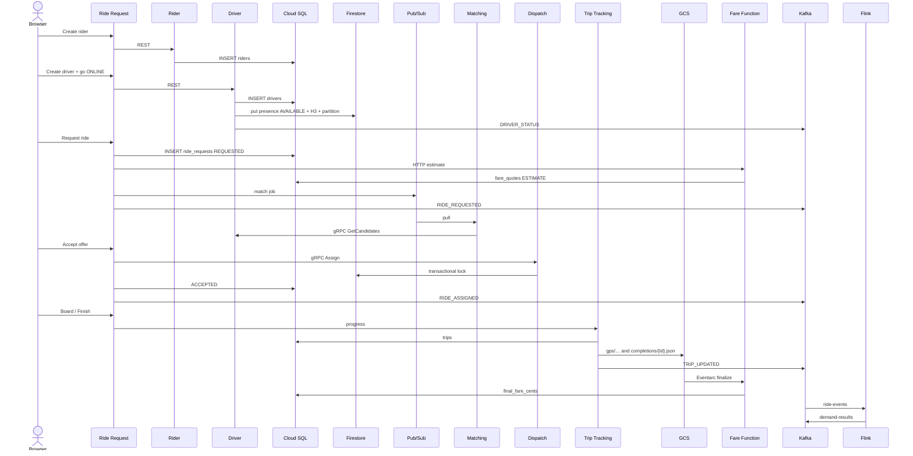

---

# Part 2 — Cloud deployment architecture

## 2.1 High-level GCP architecture

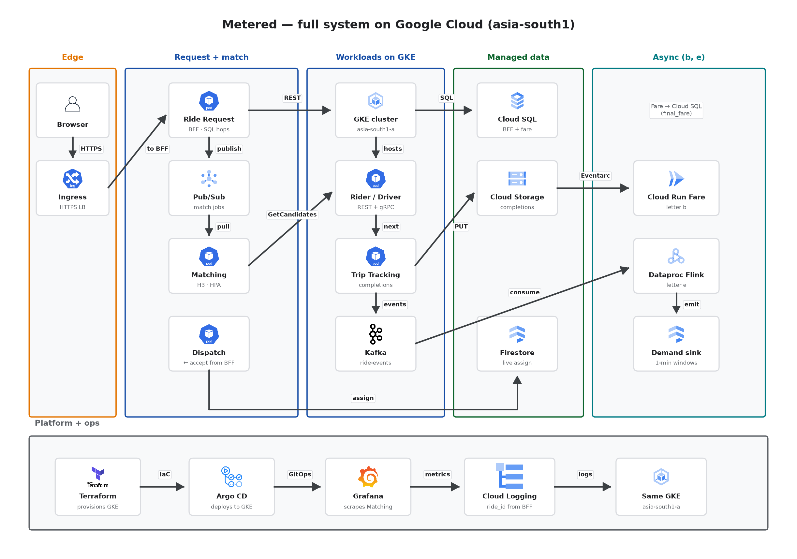

*Figure 1 — Metered on Google Cloud (`asia-south1`). Full-resolution source: `docs/diagrams/full_system.png`.*

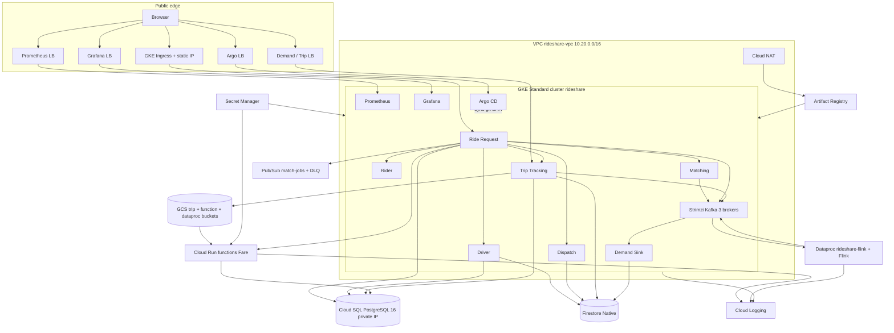

## 2.2 Network and cluster

| Resource | Value |
|---|---|
| VPC | `rideshare-vpc` (`10.20.0.0/16`) |
| Subnet | `rideshare-subnet` (`10.20.0.0/20`) |
| Pod CIDR | `rideshare-pods` (`10.24.0.0/14`) |
| Service CIDR | `rideshare-services` (`10.28.0.0/20`) |
| GKE | `rideshare`, zonal, nodes `e2-standard-2`, autoscaled |
| Namespace | `rideshare` (+ `monitoring`, `argocd` as needed) |
| Public app IP | Global static address `rideshare-ip` → Ingress |

Private nodes reach Google APIs through **Cloud NAT**. Cloud SQL uses **private IP** only. Kafka bootstrap for Dataproc uses the internal load balancer on port `9095` with TLS truststore.

## 2.3 Terraform stacks (letter a)

| Stack | Path | Provisions |
|---|---|---|
| Bootstrap | `infra/bootstrap` | State bucket, project APIs |
| Platform | `infra/platform` | VPC, GKE, Cloud SQL, Firestore, GCS, Pub/Sub, Artifact Registry, IAM, Workload Identity |
| Kubernetes | `infra/k8s` | Namespaces, secrets, ConfigMaps, Argo CD, Strimzi Kafka, topics |
| Functions | `infra/functions` | Fare estimate + finalize Cloud Functions, Eventarc on `completions/` |
| Dataproc | `infra/dataproc` | `rideshare-flink` cluster + truststore init (demo window) |

Infrastructure is declared; it is not clicked together in the console.

## 2.4 GitOps deploy path (letter d)

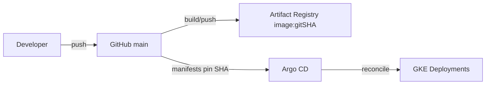

Normal service deploys do **not** use `kubectl set image`. Argo CD watches git and rolls pods to the pinned digest/tag.

## 2.5 Runtime placement summary

| Runs on GKE | Managed / serverless | Ephemeral demo |
|---|---|---|
| Rider, Driver, Ride Request, Matching, Dispatch, Trip Tracking, Demand sink | Cloud SQL, Firestore, GCS, Pub/Sub, Secret Manager, Cloud Logging | Dataproc Flink cluster |
| Strimzi Kafka, Prometheus, Grafana, Argo CD | Cloud Run functions (Fare) | |

---

# Part 3 — Microservice responsibilities

## 3.1 Responsibility matrix

| Service | Owner | Inbound | Outbound | Durable state |
|---|---|---|---|---|
| Rider | Ved | REST from Ride Request | Cloud SQL | `riders` |
| Driver | Ved | REST + gRPC `GetCandidates` | Cloud SQL, Firestore, Kafka | `drivers`, `rideshare_driver_live` |
| Ride Request | Pratham | Browser HTTPS | All private services, Pub/Sub, Kafka, Fare HTTP, SQL | `ride_requests`, hops |
| Matching | Pratham | Pub/Sub pull | Driver gRPC, SQL, Kafka | offers / ride status updates |
| Dispatch | Pratham | gRPC `Assign` | Firestore txn, hops | live assignment lock |
| Trip Tracking | Vidhu | REST from Ride Request | SQL, GCS, Firestore, Kafka | `trips`, GPS + completion objects |
| Fare | Vidhu | HTTP estimate; Eventarc finalize | SQL (`fare_quotes`, `final_fare_cents`) | quotes |
| Demand Analytics | Vidhu | Kafka `ride-events` | Kafka `demand-results` → sink → Firestore | `rideshare_demand_windows` |

## 3.2 Per-person architecture diagrams

### Ved — platform + identity

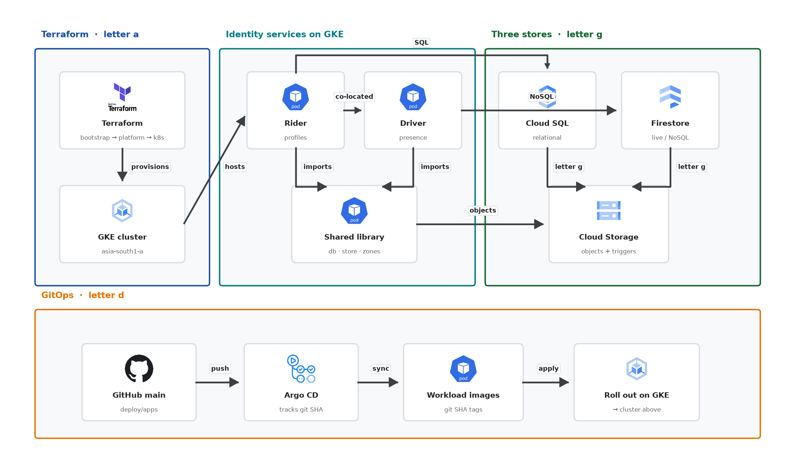

*Figure 2 — Terraform, Rider/Driver, three stores, Argo CD.*

### Pratham — interactive path

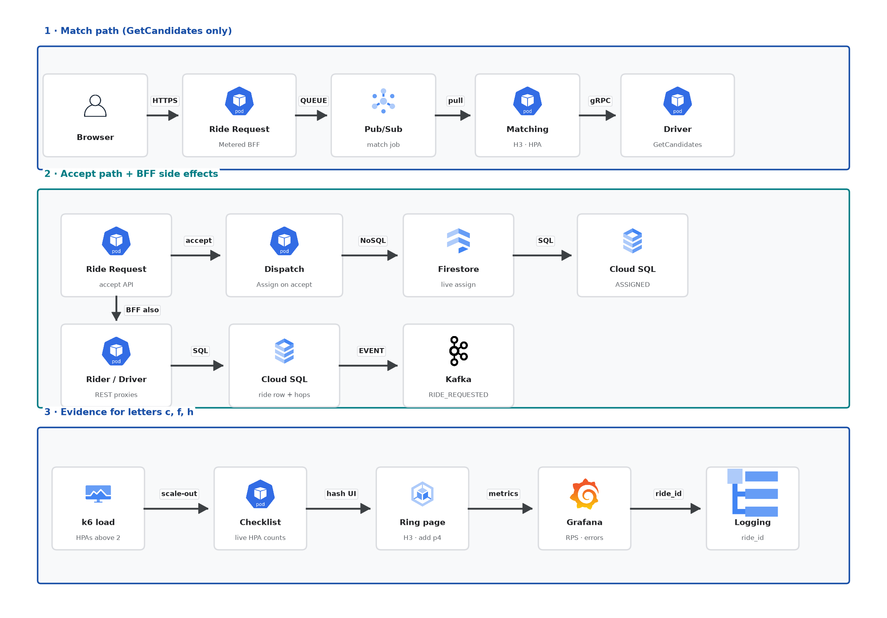

*Figure 3 — BFF, Pub/Sub matching, gRPC dispatch, hashing, observability.*

### Vidhu — completion + analytics

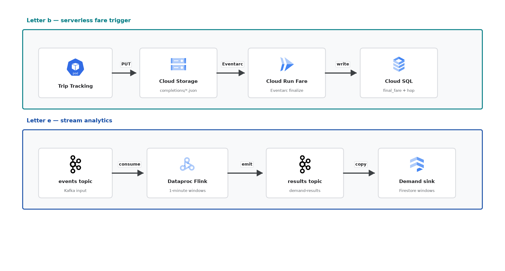

*Figure 4 — Trip → GCS → Fare; Kafka → Flink → demand.*

## 3.3 Ports and process model

| Service | HTTP | gRPC | Notes |
|---|---|---|---|
| Rider | 8001 | — | Stateless pod |
| Driver | 8002 | 9002 | Presence writer |
| Ride Request | 8003 | — | Public; serves UI |
| Matching | 8004 | — | Pub/Sub consumer workers |
| Dispatch | 8005 | 9005 | Assign authority |
| Trip Tracking | 8006 | — | Also demand page |
| Demand sink | 8010 | — | Kafka consumer |

All application pods expose `/healthz`, `/readyz`, and `/metrics`.

## 3.4 Autoscaling (letter c)

- **HPA** on Ride Request and Matching (CPU target ~60%).
- Load proof via **k6** (`loadtest/k6/`); recorded evidence under `loadtest/k6/results/`.
- Services are **stateless**; scaling out does not require sticky sessions for the core ride API.

---

# Part 4 — Interconnection mechanisms

Letter **b** requires a serverless component **and** a path that uses REST, gRPC, and message queues. Metered does both on a **single ride**.

## 4.1 Mechanism map

| Mechanism | Used for | Evidence |
|---|---|---|
| **REST** | Browser → Ride Request; BFF → Rider/Driver/Trip; Fare estimate HTTP | Trace hops `REST` |
| **gRPC** | `GetCandidates` (Matching→Driver); `Assign` (Ride Request→Dispatch) | Trace hops `gRPC` |
| **Pub/Sub** | Match **command** queue `rideshare-match-jobs` (+ DLQ after 5 attempts) | Trace hops `QUEUE` |
| **Kafka** | Domain log `ride-events`; analytics `demand-results` | Events + demand page |
| **Eventarc** | GCS object finalize → Fare finalize function | Function logs + `final_fare_cents` |
| **SQL** | Profiles, rides, trips, quotes, `ride_hops` | Cloud SQL |
| **NoSQL** | Live drivers + demand windows | Firestore |
| **Object** | `gps/{ride_id}/…`, `completions/{ride_id}.json` | GCS |

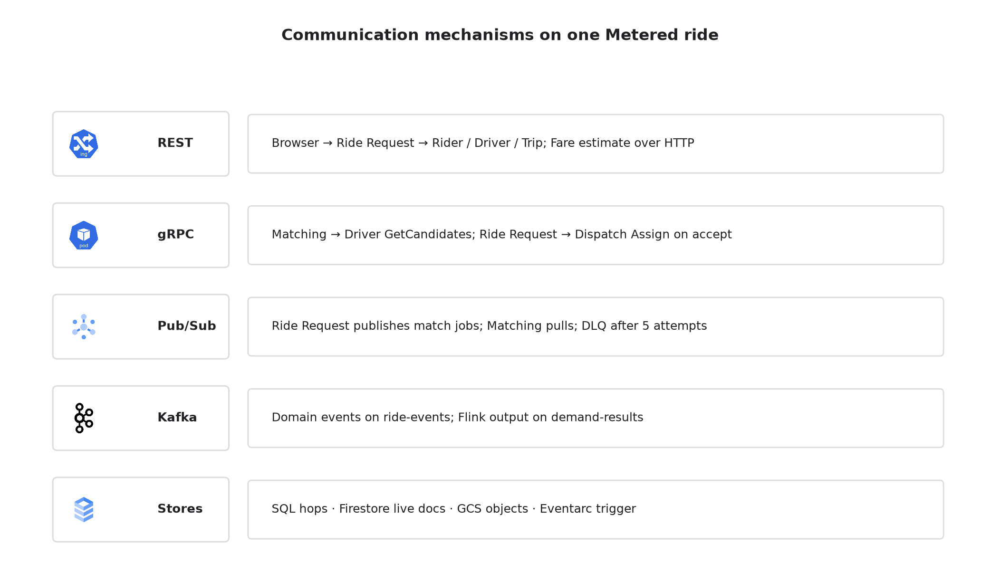

*Figure 5 — REST, gRPC, and queues on one ride path.*

## 4.2 Why Pub/Sub and Kafka both exist

| Bus | Semantics | Why |
|---|---|---|
| Pub/Sub | At-least-once **job** delivery with ack / DLQ | Matching must process a discrete “please match this ride” command |
| Kafka | Ordered **event log** for analytics and fan-out | Flink needs a stream of domain facts (`RIDE_REQUESTED`, `RIDE_ASSIGNED`, `TRIP_UPDATED`, `DRIVER_STATUS`) |

## 4.3 Hop tracing

Every service inserts into `ride_hops (ride_id, service, mechanism, store, detail)`. The Trace UI reconstructs the ride as an ordered timeline — the viva proof that mechanisms and stores actually fired.

---

# Part 5 — Live zoning and consistent hashing

Letter **f** is a **declared concept applied to the domain** and shown live (Ring page), not a slide-only buzzword.

## 5.1 Zones are H3 cells

There is **no fixed city bounding box**.

- Input: live latitude / longitude (browser geolocation).
- Zone id: H3 cell at resolution **`H3_RESOLUTION=8`** (~0.7 km²).
- Neighbourhood: `grid_disk(cell, H3_NEIGHBOR_K)` with default **`k=1`** (cell + six neighbours).

Fare **distance** uses raw pickup/drop coordinates. H3 is for **partitioning and demand**, not for pricing geometry.

## 5.2 Consistent hash ring

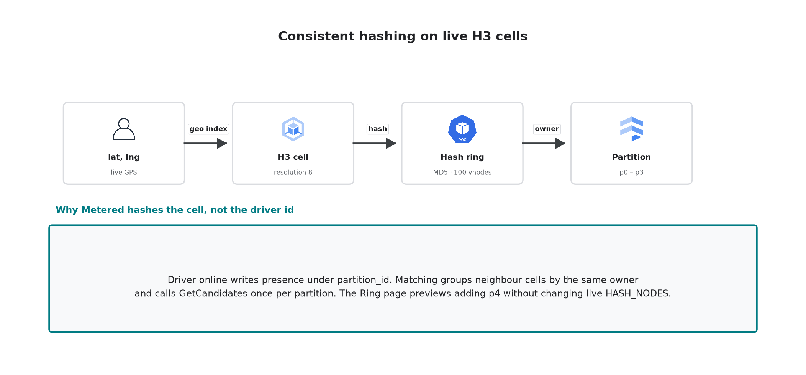

*Figure 6 — H3 cells on ring partitions `p0…p3`.*

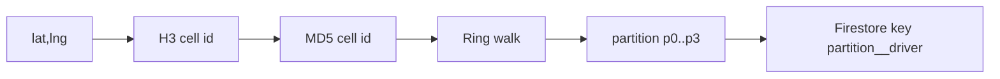

| Property | Metered choice |
|---|---|
| Ring nodes | `HASH_NODES=p0,p1,p2,p3` |
| Key hashed | **H3 cell id** (not driver id) |
| Placement | First clockwise ring point |
| Matching | Group neighbour cells by partition owner; one `GetCandidates` per owner |
| Ring UI preview | Can show hypothetical `p4` without mutating live `HASH_NODES` |

**Why hash cells, not drivers?** A neighbourhood of cells tends to land in fewer partitions, so Matching issues fewer cross-partition queries. Hashing driver ids would scatter geographically close drivers across all partitions.

## 5.3 Assignment correctness vs hashing

Consistent hashing decides **where to look**.  
Firestore transactions in Dispatch decide **who wins**.  
Those concerns stay separate on purpose.

---

# Part 6 — Why these GCP products

| Product | Letter / role | Why this product (not a generic alternative) |
|---|---|---|
| **Terraform** | **a** | Entire foundation is code-reviewed and reproducible |
| **GKE Standard** | **c** | Managed Kubernetes with HPA, Workload Identity, node pools |
| **Argo CD** | **d** | Pull-based GitOps; cluster converges to git |
| **Cloud SQL PostgreSQL 16** | **g** | Relational integrity for riders, rides, trips, fares, hops |
| **Firestore Native** | **g** | Low-latency live presence + transactional assign |
| **Cloud Storage** | **g** + trigger | Durable GPS/completion objects; Eventarc source |
| **Pub/Sub** | path / **b** | Managed command queue with DLQ |
| **Kafka (Strimzi on GKE)** | **e** input | Assignment requires Flink←Kafka; TLS inside VPC |
| **Cloud Run functions 2nd gen** | **b** | Serverless Fare; scales to zero; HTTP + event triggers |
| **Eventarc** | **b** | GCS finalize → function without polling |
| **Dataproc + Flink** | **e** | Stateful 1-minute event-time windows with checkpoints |
| **Artifact Registry** | supply chain | Region-local images tagged by git SHA |
| **Secret Manager** | security | DB URL / demo token out of git |
| **Cloud Logging** | **h** | Central logs from GKE, Functions, Dataproc |
| **Prometheus + Grafana** | **h** | RPS, errors, latency, cluster health on the demo path |
| **Cloud NAT / VPC** | networking | Private nodes + private SQL without public DB |

### Flink window (letter e) — exact analytics contract

Flink `DemandJob` reads `ride-events`, keys by H3 zone, and emits one JSON object per cell per **1-minute event-time window** to `demand-results`:

| Field | Meaning |
|---|---|
| `unique_riders` | Distinct rider ids requesting in the window |
| `request_count` | `RIDE_REQUESTED` count |
| `assigned_count` | `RIDE_ASSIGNED` count |
| `online_drivers` | Drivers whose latest `DRIVER_STATUS` in-window is `ONLINE` |
| `queue_length` | `max(0, requests - assigned)` |
| `imbalance` | `requests / max(online_drivers, 1)` |

Dataproc image **2.2** ships **Flink 1.17** / **Java 11**; the job JAR targets that runtime.

---

# Appendix A — Data model

## A.1 Cloud SQL (relational)

```text
riders(id, name, phone UNIQUE, email, created_at)
drivers(id, name, phone UNIQUE, vehicle_number, created_at)
ride_requests(id, rider_id, pickup/drop zones + lat/lng, status,
              estimated_fare_cents, final_fare_cents, surge,
              assigned_driver_id, assigned_partition_id, idempotency_key UNIQUE, …)
trips(ride_id PK, driver_id, status, distance_km, duration_sec, started_at, completed_at, …)
fare_quotes(id, ride_id, kind ESTIMATE|FINAL, amount_cents, surge, distance_km, breakdown JSONB, …)
ride_hops(id, ride_id, service, mechanism, store, detail JSONB, created_at)
```

## A.2 Firestore (NoSQL)

| Collection | Keying | Contents |
|---|---|---|
| `rideshare_driver_live` | `{partition_id}__{driver_id}` | status (`AVAILABLE`/…), H3 cell, location, ride lock fields |
| `rideshare_demand_windows` | zone + window bounds | Flink aggregates for the Demand page |

## A.3 GCS (object)

| Prefix | Writer | Consumer |
|---|---|---|
| `gps/{ride_id}/…` | Trip Tracking | Audit / demo |
| `completions/{ride_id}.json` | Trip Tracking | Eventarc → Fare finalize |
| `flink/demand-analytics.jar` | Build/upload | Dataproc job |

## A.4 Ride status machine (simplified)

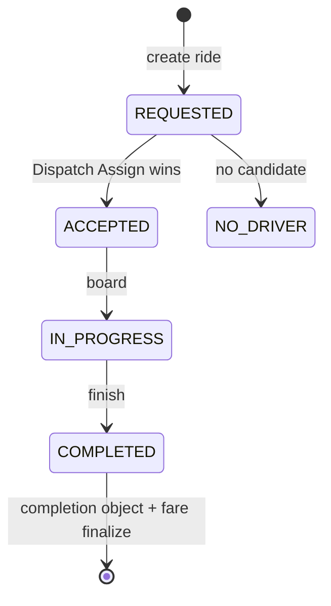

---

# Appendix B — Reliability and correctness

- **Exactly-one live driver:** Firestore transaction in Dispatch; second ride cannot steal an `AVAILABLE` driver.
- **Idempotent assign:** same `ride_id` retry is safe.
- **Idempotent create:** `ride_requests.idempotency_key` unique.
- **Pub/Sub DLQ:** after 5 delivery attempts → `rideshare-match-jobs-dlq`.
- **Stateless compute:** pods scale horizontally; state lives in SQL/Firestore/GCS/Kafka.
- **Flink checkpoints:** enabled (60s) for window state recovery.
- **Probes + resources:** readiness/liveness; CPU requests/limits feed HPA.

---

# Appendix C — Security

- Cloud SQL **private IP** only.
- Kafka **TLS** inside the VPC; Dataproc uses a truststore installed by init action.
- Secrets in **Secret Manager** (database URL, demo token); not committed.
- **Workload Identity:** each Kubernetes service account maps to a dedicated Google SA with least privilege.
- Public UI origin is Ride Request only; conflict/demo endpoints require `X-Demo-Token` where applicable.
- Encryption at rest: Google-managed for SQL, Firestore, GCS.

---

# Appendix D — Observability (letter h)

| Signal | Tool | What we show |
|---|---|---|
| Metrics | Prometheus scrapes `/metrics` | RPS, errors, latency |
| Dashboards | Grafana | Cluster + service panels |
| Logs | Cloud Logging | JSON logs; filter `jsonPayload.ride_id` |
| App trace | Trace page | Ordered `ride_hops` |
| Scorecard | Checklist page | Requirement rows → Proven when evidence visible |
| Scale proof | k6 results | HPA replica growth under load |

There is no separate Fluent Bit DaemonSet: GKE ships container logs to Cloud Logging.

---

# Appendix E — Operations and cost

| Keep for viva window | Destroy after presentation |
|---|---|
| GKE, SQL, Firestore, GCS, Pub/Sub, Functions, Kafka, Grafana, Argo, public LBs | **Dataproc `rideshare-flink`** (largest avoidable burn) |

Standing cost is dominated by GKE nodes, Cloud SQL, NAT, and Kafka brokers. Cloud Run scales to zero when idle. Course teardown disables deletion protection / final snapshots so destroy is predictable.

### Live demo surfaces (no localhost)

| Surface | Purpose |
|---|---|
| App Ingress | End-to-end ride + checklist + trace + ring |
| Demand page LB | Flink window results |
| Grafana LB | Metrics |
| Argo CD LB | GitOps sync state |
| Prometheus LB | Raw scrape / targets |

Exact IPs and logins for the current deployment are maintained in [`docs/teammates/03-ui-and-demo.md`](teammates/03-ui-and-demo.md).

---

# Appendix F — Requirement letters → design anchors

| Letter | Design anchor in this document |
|---|---|
| **a** | Part 2.3 Terraform stacks |
| **b** | Part 4 + Fare in Part 3 + Figure 5 |
| **c** | Part 3.4 HPA + k6 |
| **d** | Part 2.4 GitOps |
| **e** | Part 6 Flink window contract + Figure 4 |
| **f** | Part 5 + Figure 6 |
| **g** | Part 6 table + Appendix A |
| **h** | Appendix D |

---

# Appendix G — Team ownership (submission)

| Member | ID | Services | Letters |
|---|---|---|---|
| Ved Pahune | 2026H1030056P | Rider, Driver (+ platform Terraform/GitOps/stores) | a, d, g |
| Pratham Shah | 2026H1030063P | Ride Request, Matching, Dispatch (+ UI, HPA, hashing, observability) | c, f, h |
| Vidhu Kant Sharma | 2026H1030053P | Trip Tracking, Fare, Demand Analytics | b, e |

The enrolled group has **three** members. The brief’s “two services each” line assumes four; the service split is **3 / 3 / 2** so every service and every letter still has a single owner. See [`task_division.txt`](../task_division.txt).
