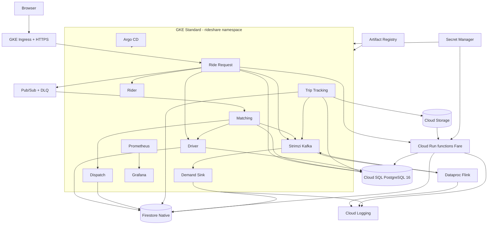

# Ride Sharing — Design Document

## 1. System overview

Ride Sharing is a cloud-native ride-hailing system built as eight microservices
on Google Cloud Platform. A browser uses one public web application, the Ride
Request service. All other services are private. The system separates the
synchronous ride path, the asynchronous matching path, the event stream and the
analytics path.

The eight services are:

1. Rider Service
2. Driver Service
3. Ride Request Service
4. Matching Engine
5. Dispatch Service
6. Trip Tracking Service
7. Fare Service
8. Demand Analytics Service

Demand Analytics includes a small demand-sink process. The sink belongs to the
same service, so the count remains eight.

## 2. Cloud deployment architecture

The platform is provisioned by Terraform in five stacks:

- `infra/bootstrap` — GCS state bucket and project APIs.
- `infra/platform` — network, GKE, Cloud SQL, Firestore, GCS, Pub/Sub,
  Artifact Registry, Secret Manager and IAM.
- `infra/k8s` — namespaces, secrets, config, Argo CD, Strimzi and Kafka topics.
- `infra/functions` — the serverless Fare functions, applied when the source
  exists.
- `infra/dataproc` — the stream cluster, applied only for the demo.

## 3. Microservice responsibilities

| Service | Responsibility | Storage |
|---|---|---|
| Rider | Rider profiles | Cloud SQL |
| Driver | Driver profiles, live presence, candidate lookup over gRPC | Cloud SQL, Firestore |
| Ride Request | Public BFF, ride creation, estimate, match command, trace, checklist | Cloud SQL |
| Matching | Pull match jobs, group H3 neighbours by partition, call Driver and Dispatch | Cloud SQL, Pub/Sub |
| Dispatch | Transactional driver assignment over gRPC | Firestore |
| Trip Tracking | Trip progress, GPS samples, completion object, driver release | Cloud SQL, GCS, Firestore, Kafka |
| Fare | HTTP estimate and Eventarc final fare | Cloud SQL, Firestore, Secret Manager |
| Demand Analytics | Flink 1-minute window over Kafka, results topic, demand sink | Kafka, Firestore |

## 4. Interconnection mechanisms

| Mechanism | Where |
|---|---|
| REST | Browser to Ride Request; Ride Request to Rider/Driver/Trip; Ride Request to Fare estimate |
| gRPC | Matching to Driver `GetCandidates`; Matching to Dispatch `Assign` |
| Pub/Sub | Ride Request to Matching match command; DLQ after 5 attempts |
| Kafka | `ride-events` producer path; Flink input; `demand-results` output |
| SQL | Relational state and `ride_hops` trace |
| NoSQL | Live driver state and demand windows in Firestore |
| Object storage | GPS samples and completion JSON in GCS |
| Eventarc | GCS completion object to Fare final function |

Every service writes a `ride_hops` row. The trace page reads that table and
shows REST, gRPC, QUEUE, SQL, NOSQL, OBJECT and EVENT hops for one ride.

## 5. Live zoning and consistent hashing

A zone is an H3 cell computed from the live latitude/longitude. There is no fixed
grid and no fixed city. The default resolution is 8, about 0.7 km² per cell.

- Driver presence: `zone_for(lat, lng)`.
- Neighbours: `grid_disk(cell, k)`, default `k=1`.
- Ring: partitions `p0,p1,p2,p3`; `MD5(cell_id)` chooses the first ring point
  clockwise.
- Matching groups neighbour cells by partition owner and queries each partition.
- Adding `p4` moves only the cells whose owner changes.
- The ring page samples cells around the browser's live location and previews
  the before/after ownership. It never changes `HASH_NODES`.

Hashing the cell keeps a neighbourhood mostly in one partition. Hashing driver
ids would scatter a neighbourhood across every partition.

Fare distance uses the actual pickup/drop coordinates. H3 cells are used for
partitioning and demand aggregation, not for fare distance.

## 6. Why these GCP products

- **GKE Standard** gives managed Kubernetes, HPA, Workload Identity and
  Cloud Logging without managing nodes. It is letter **c**.
- **Cloud SQL PostgreSQL 16** holds relational state and the trace. Joins and
  transactions are natural for riders, drivers, rides, trips, fares and hops.
- **Firestore Native** holds live driver availability and demand windows. The
  assign path is a transaction, so two matchers cannot both win.
- **Cloud Storage** holds GPS samples and completion JSON. The completion object
  triggers Fare. It is the object store in letter **g** and the trigger in
  letter **b**.
- **Pub/Sub** is the match command queue. A match must be acknowledged, not
  replayed as an event, so it is not Kafka.
- **Strimzi Kafka on GKE** is the event log. The assignment requires Flink to
  consume Kafka. Brokers are internal and TLS is enabled.
- **Cloud Run functions 2nd gen** is the serverless Fare service. Estimate is
  HTTP; final fare is an Eventarc event. The runtime scales to zero.
- **Dataproc with Flink** runs the stateful 1-minute window. Checkpoints go to
  GCS and the state backend is RocksDB.
- **Artifact Registry** stores images by git SHA.
- **Secret Manager** stores the database URL and demo token outside git.
- **Workload Identity** gives each Kubernetes service account a separate
  Google identity.
- **Cloud Logging** centralizes pod, GKE, Dataproc and Cloud Run logs.
- **Prometheus and Grafana** run on GKE and provide RPS, error rate, latency and
  cluster health panels.

## 7. Reliability and correctness

- Driver assignment is a Firestore transaction. A second assignment for a
  different ride fails.
- Assignment is idempotent for the same `ride_id`, so a Pub/Sub retry is safe.
- Ride creation uses `idempotency_key`.
- Pub/Sub has a dead-letter topic after 5 delivery attempts.
- Services are stateless; ride state is in Cloud SQL and Firestore.
- Pods run as UID 65532 with probes, CPU requests and limits.
- HPAs target 60 percent CPU on Ride Request and Matching.
- Images are pinned to a git SHA and deployed by Argo CD.

## 8. Security

- Cloud SQL private IP only.
- Firestore and GCS use Google-managed encryption at rest.
- Kafka uses TLS inside the VPC.
- Secret Manager holds the database URL and demo token.
- Each Kubernetes service account has a dedicated Google service account.
- The public UI only exposes the Ride Request origin.
- The conflict demo endpoint requires `X-Demo-Token`.

## 9. Observability

- Every service exposes `/healthz`, `/readyz` and `/metrics`.
- Prometheus scrapes pods through a PodMonitor.
- Grafana shows RPS, 5xx rate, p95 latency and node health.
- Cloud Logging receives JSON stdout from every pod, Dataproc and Cloud Run.
- The trace page is the application-level evidence for the ride path.

## 10. Cost and operations

The standing cost is GKE, Cloud SQL, Cloud NAT, internal load balancers and the
Strimzi brokers. Dataproc is created only for the stream demo and destroyed the
same day. Cloud Run scales to zero when idle. The course project disables
deletion protection and final snapshots so teardown is predictable.
